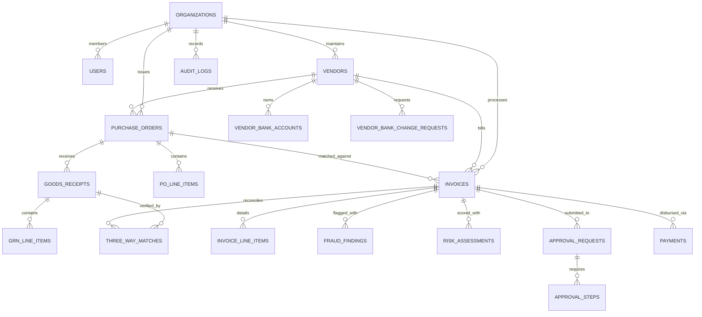

# InvoiceGuard — Database Schema & Data Dictionary

The InvoiceGuard persistence layer is implemented in PostgreSQL 15+ hosted on Supabase, secured with Row Level Security (RLS) policies, foreign key integrity, and automated timestamp triggers.

---

## 1. Entity-Relationship Overview

---

## 2. Core Tables and Schema Specification

### 2.1 Organizations & Multi-Tenancy
- **`organizations`**:
  - `id` (UUID, Primary Key)
  - `name` (TEXT, Not Null)
  - `slug` (TEXT, Unique, Not Null)
  - `currency` (VARCHAR(3), Default `'USD'`)
  - `created_at`, `updated_at` (TIMESTAMPTZ)
- **`users`**:
  - `id` (UUID, Primary Key, references `auth.users`)
  - `organization_id` (UUID, FK -> `organizations.id`)
  - `email` (TEXT, Unique, Not Null)
  - `name` (TEXT, Not Null)
  - `role` (ENUM: `'ADMIN'`, `'FINANCE_STAFF'`, `'APPROVER'`, `'AUDITOR'`)
  - `status` (ENUM: `'ACTIVE'`, `'PENDING'`, `'SUSPENDED'`)
  - `department` (TEXT)
  - `approval_limit` (NUMERIC(15,2))

---

### 2.2 Master Vendor Directory & Maker-Checker Banking
- **`vendors`**:
  - `id` (UUID, Primary Key)
  - `organization_id` (UUID, FK -> `organizations.id`)
  - `name` (TEXT, Not Null)
  - `tax_id` (TEXT, e.g. GSTIN/PAN)
  - `email`, `phone`, `address` (TEXT)
  - `status` (ENUM: `'ACTIVE'`, `'UNDER_REVIEW'`, `'SUSPENDED'`, `'BLOCKED'`)
  - `risk_score` (INT, Default 0)
  - `risk_tier` (ENUM: `'LOW'`, `'MEDIUM'`, `'HIGH'`, `'CRITICAL'`)
  - `created_at`, `updated_at` (TIMESTAMPTZ)
- **`vendor_bank_accounts`**:
  - `id` (UUID, Primary Key)
  - `vendor_id` (UUID, FK -> `vendors.id`)
  - `bank_name` (TEXT, Not Null)
  - `account_number_hash` (TEXT, SHA-256 for duplicate matching)
  - `account_number_encrypted` (TEXT, Masked for display)
  - `routing_code` (TEXT, IFSC / SWIFT / ABA)
  - `is_primary` (BOOLEAN, Default false)
  - `verification_status` (ENUM: `'UNVERIFIED'`, `'VERIFIED'`, `'REJECTED'`)
  - `verified_at`, `verified_by` (UUID)
- **`vendor_bank_change_requests`**:
  - `id` (UUID, Primary Key)
  - `vendor_id` (UUID, FK -> `vendors.id`)
  - `requested_by` (UUID, FK -> `users.id` — Maker)
  - `new_bank_name`, `new_account_number`, `new_routing_code` (TEXT)
  - `status` (ENUM: `'PENDING'`, `'APPROVED'`, `'REJECTED'`)
  - `reviewed_by` (UUID, FK -> `users.id` — Checker)
  - `callback_verified` (BOOLEAN, Default false)
  - `notes` (TEXT)

---

### 2.3 Procurement (Purchase Orders & Goods Receipts)
- **`purchase_orders`**:
  - `id` (UUID, Primary Key)
  - `po_number` (TEXT, Unique per Org)
  - `vendor_id` (UUID, FK -> `vendors.id`)
  - `total_amount` (NUMERIC(15,2))
  - `currency` (VARCHAR(3))
  - `status` (ENUM: `'OPEN'`, `'PARTIALLY_BILLED'`, `'FULLY_BILLED'`, `'CLOSED'`)
  - `issue_date`, `delivery_date` (DATE)
- **`po_line_items`**:
  - `id`, `purchase_order_id`, `item_number`, `description`, `quantity`, `unit_price`, `total_price`
- **`goods_receipts` (GRNs)**:
  - `id` (UUID, Primary Key)
  - `grn_number` (TEXT, Unique per Org)
  - `purchase_order_id` (UUID, FK -> `purchase_orders.id`)
  - `received_date` (DATE)
  - `received_by` (UUID)
  - `status` (ENUM: `'PENDING_INSPECTION'`, `'ACCEPTED'`, `'REJECTED'`, `'PARTIALLY_ACCEPTED'`)
- **`grn_line_items`**:
  - `id`, `goods_receipt_id`, `item_description`, `quantity_received`, `quantity_accepted`, `quantity_rejected`

---

### 2.4 Invoices & Line Items
- **`invoices`**:
  - `id` (UUID, Primary Key)
  - `organization_id` (UUID, FK -> `organizations.id`)
  - `vendor_id` (UUID, FK -> `vendors.id`)
  - `purchase_order_id` (UUID, FK -> `purchase_orders.id`, Nullable)
  - `invoice_number` (TEXT, Not Null)
  - `invoice_date`, `due_date` (DATE)
  - `currency` (VARCHAR(3), Default `'USD'`)
  - `subtotal`, `tax_amount`, `total_amount` (NUMERIC(15,2))
  - `file_url`, `file_hash` (SHA-256 for binary duplicate detection)
  - `status` (ENUM: `'DRAFT'`, `'PENDING_SCAN'`, `'NEEDS_REVIEW'`, `'APPROVED'`, `'REJECTED'`, `'PAID'`, `'ON_HOLD'`)
  - `submitted_by` (UUID, FK -> `users.id`)
  - `created_at`, `updated_at` (TIMESTAMPTZ)
- **`invoice_line_items`**:
  - `id`, `invoice_id`, `description`, `quantity`, `unit_price`, `tax_rate`, `total_price`

---

### 2.5 Fraud Engine & Risk Scoring
- **`fraud_rules`**:
  - `id` (UUID, Primary Key)
  - `rule_code` (TEXT, Unique, e.g. `'EXACT_DUPLICATE'`, `'BANK_MISMATCH'`)
  - `name`, `description` (TEXT)
  - `category` (ENUM: `'DUPLICATE'`, `'BANKING'`, `'THRESHOLD'`, `'VENDOR'`, `'PROCUREMENT'`, `'STATISTICAL'`, `'TAX'`)
  - `is_enabled` (BOOLEAN, Default true)
  - `weight` (NUMERIC(5,2), Default 1.0)
  - `threshold_config` (JSONB)
- **`fraud_findings`**:
  - `id` (UUID, Primary Key)
  - `invoice_id` (UUID, FK -> `invoices.id`)
  - `rule_id` (UUID, FK -> `fraud_rules.id`)
  - `severity` (ENUM: `'LOW'`, `'MEDIUM'`, `'HIGH'`, `'CRITICAL'`)
  - `is_hard_stop` (BOOLEAN, Default false)
  - `title`, `description` (TEXT)
  - `detected_values`, `expected_values` (JSONB)
  - `confidence_score` (INT)
- **`risk_assessments`**:
  - `id` (UUID, Primary Key)
  - `invoice_id` (UUID, FK -> `invoices.id`)
  - `overall_score` (INT, 0–100)
  - `risk_level` (ENUM: `'LOW'`, `'MEDIUM'`, `'HIGH'`, `'CRITICAL'`)
  - `category_scores` (JSONB, Breakdown across 7 categories)
  - `scoring_factors` (JSONB, Explainable weighted contribution list)
  - `hard_stop_triggered` (BOOLEAN)
  - `assessed_at` (TIMESTAMPTZ)

---

### 2.6 Approvals, Payments & Audit
- **`approval_policies`**:
  - `id`, `name`, `min_amount`, `max_amount`, `risk_level_threshold`, `required_role`, `step_order`
- **`approval_requests`**:
  - `id`, `invoice_id`, `status` (`'PENDING'`, `'APPROVED'`, `'REJECTED'`, `'ESCALATED'`)
- **`approval_steps`**:
  - `id`, `approval_request_id`, `step_order`, `assigned_role`, `assigned_user_id`, `status`, `decided_at`, `notes`
- **`payments`**:
  - `id`, `invoice_id`, `amount`, `currency`, `payment_method`, `reference_number`, `status` (`'UNPAID'`, `'SCHEDULED'`, `'PROCESSING'`, `'PAID'`, `'FAILED'`, `'CANCELLED'`), `paid_at`
- **`audit_logs`**:
  - `id` (UUID, Primary Key)
  - `organization_id` (UUID)
  - `user_id` (UUID, Nullable for system actions)
  - `user_email`, `user_role` (TEXT)
  - `action` (TEXT, e.g. `'INVOICE_SUBMITTED'`, `'FRAUD_FLAGGED'`, `'INVOICE_APPROVED'`)
  - `entity_type` (TEXT), `entity_id` (UUID)
  - `old_values`, `new_values` (JSONB)
  - `ip_address`, `user_agent` (TEXT)
  - `created_at` (TIMESTAMPTZ)

